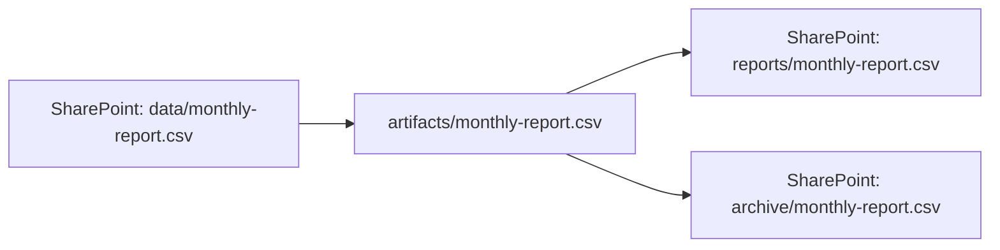
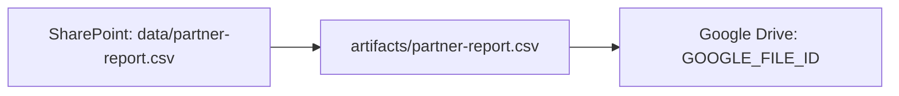
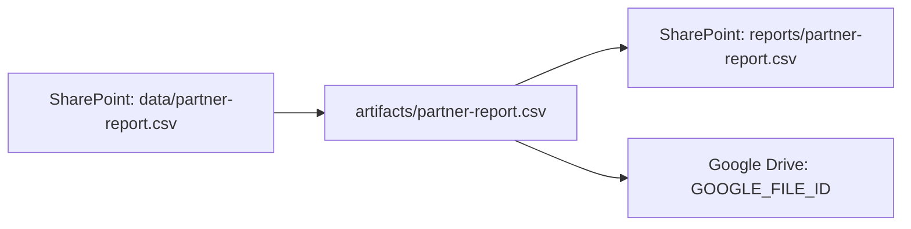
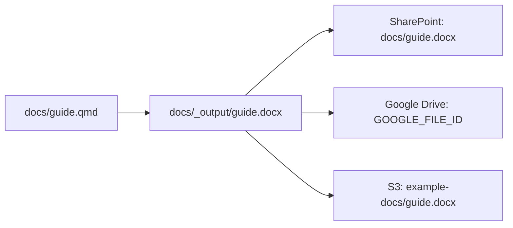
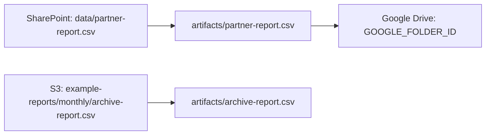
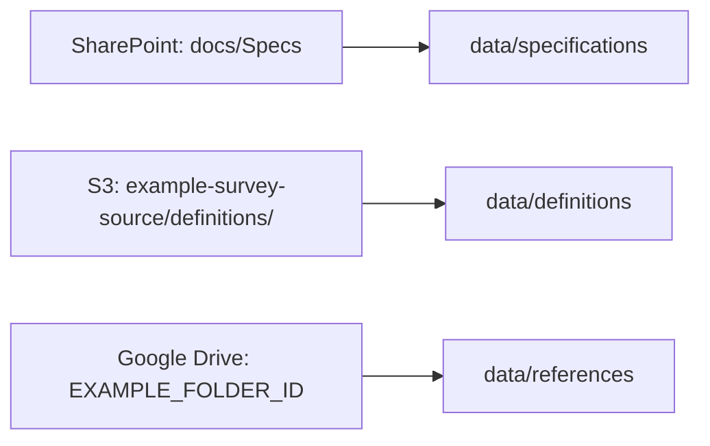

# Use cases

Each resource has one local artifact `path`. `sources` describe where it
came from; `targets` describe every intended publication destination.
`pull` downloads **one remote source** to `path`, and `push` uploads
`path` to **all targets**. Run those commands as separate steps.

The YAML blocks below and their Mermaid diagrams are generated from the
descriptors in `examples/use-cases/`. Copy a saved descriptor into your
project's `config/fileroute.yaml` and replace the example URLs to adapt it.

## One SharePoint source and two SharePoint targets

Retrieve a report, then publish copies to two SharePoint sites. This is a
supported end-to-end transfer if credentials grant access to all sites.

<!-- example:sharepoint-two-targets:start -->
```yaml
# yaml-language-server: $schema=../../schemas/fileroute-catalog.schema.json
resources:
  monthly-report:
    path: artifacts/monthly-report.csv
    sources:
      - path: https://contoso.sharepoint.com/sites/data/Shared%20Documents/monthly-report.csv
    targets:
      - path: https://contoso.sharepoint.com/sites/reports/Shared%20Documents/monthly-report.csv
      - path: https://contoso.sharepoint.com/sites/archive/Shared%20Documents/monthly-report.csv
```
<!-- example:sharepoint-two-targets:end -->

<!-- diagram:sharepoint-two-targets:start -->

<!-- diagram:sharepoint-two-targets:end -->

```bash
uvx fileroute pull config/fileroute.yaml --dry-run
uvx fileroute pull config/fileroute.yaml
uvx fileroute push config/fileroute.yaml --dry-run
uvx fileroute push config/fileroute.yaml
```

## SharePoint source and Google Drive target

Retrieve from SharePoint, then replace an existing Google Drive file by its ID.
To create a new Drive file instead, target its existing folder URL.

<!-- example:sharepoint-google-drive:start -->
```yaml
# yaml-language-server: $schema=../../schemas/fileroute-catalog.schema.json
resources:
  partner-report:
    path: artifacts/partner-report.csv
    sources:
      - path: https://contoso.sharepoint.com/sites/data/Shared%20Documents/partner-report.csv
    targets:
      - path: https://drive.google.com/file/d/GOOGLE_FILE_ID/view
```
<!-- example:sharepoint-google-drive:end -->

<!-- diagram:sharepoint-google-drive:start -->

<!-- diagram:sharepoint-google-drive:end -->

## SharePoint source, SharePoint and Google Drive targets

One artifact can declare both destinations. `push` publishes to both when
credentials permit access; it never deletes files outside the descriptor.

<!-- example:sharepoint-mixed-targets:start -->
```yaml
# yaml-language-server: $schema=../../schemas/fileroute-catalog.schema.json
resources:
  partner-report:
    path: artifacts/partner-report.csv
    sources:
      - path: https://contoso.sharepoint.com/sites/data/Shared%20Documents/partner-report.csv
    targets:
      - path: https://contoso.sharepoint.com/sites/reports/Shared%20Documents/partner-report.csv
      - path: https://drive.google.com/file/d/GOOGLE_FILE_ID/view
```
<!-- example:sharepoint-mixed-targets:end -->

<!-- diagram:sharepoint-mixed-targets:start -->

<!-- diagram:sharepoint-mixed-targets:end -->

## Local authoring source, three remote targets

Render `docs/guide.qmd` to `docs/_output/guide.docx` with Quarto first.
The local source is provenance; `pull` neither copies nor renders it.

<!-- example:local-three-targets:start -->
```yaml
# yaml-language-server: $schema=../../schemas/fileroute-catalog.schema.json
resources:
  guide:
    path: docs/_output/guide.docx
    sources:
      - path: docs/guide.qmd
    targets:
      - path: https://contoso.sharepoint.com/sites/docs/Shared%20Documents/guide.docx
      - path: https://drive.google.com/file/d/GOOGLE_FILE_ID/view
      - path: s3://example-docs/guide.docx
```
<!-- example:local-three-targets:end -->

<!-- diagram:local-three-targets:start -->

<!-- diagram:local-three-targets:end -->

After rendering the document, preview all three destinations with
`uv run fileroute push examples/use-cases/local-three-targets.yaml --dry-run`.
The SharePoint destination is a file path, the Google Drive ID identifies an
existing file, and the S3 URI gives the exact object key. Configure credentials
with write access to each target before running `push` without `--dry-run`.

## Separate source and target identities

Read SharePoint as `work-reader`, publish to Google Drive as `partner-writer`,
and retrieve another report through the AWS-backed `archive-reader` profile.
Configure these names locally using [Authentication](authentication.md).
The synthetic [profile template](https://github.com/mbkranz/fileroute/blob/main/examples/auth/profiles.yaml)
shows their settings. Each location selects its identity explicitly.

<!-- example:profile-identities:start -->
```yaml
# yaml-language-server: $schema=../../schemas/fileroute-catalog.schema.json
resources:
  partner-report:
    path: artifacts/partner-report.csv
    sources:
      - path: https://contoso.sharepoint.com/sites/data/Shared%20Documents/partner-report.csv
        authProfile: work-reader
    targets:
      - path: https://drive.google.com/drive/folders/GOOGLE_FOLDER_ID
        authProfile: partner-writer
  archive-report:
    path: artifacts/archive-report.csv
    sources:
      - path: s3://example-reports/monthly/archive-report.csv
        authProfile: archive-reader
```
<!-- example:profile-identities:end -->

<!-- diagram:profile-identities:start -->

<!-- diagram:profile-identities:end -->

```bash
uvx fileroute pull examples/use-cases/profile-identities.yaml --dry-run
uvx fileroute resolve examples/use-cases/profile-identities.yaml
uvx fileroute auth login sharepoint --profile work-reader
uvx fileroute auth login gdrive --profile partner-writer
aws sso login --profile team-dev
uvx fileroute pull examples/use-cases/profile-identities.yaml
uvx fileroute push examples/use-cases/profile-identities.yaml --select partner-report
```

The first two commands need no credentials. Replace the synthetic URLs and
configure the profiles before running the online commands. The diagram shows
locations and transfer intent; authentication profiles do not alter file identity.

To regenerate and check these blocks after editing a saved descriptor:

```bash
poe docs-update
poe docs-check
```

See [Transfers](transfers.md) for inheritance and execution details and
[Descriptor diagrams](diagram.md) for SVG, HTML, and Markdown output.

## Discover files and pull a concrete catalog

A single catalog can declare SharePoint, S3 and Google Drive roots. Replace the
example locators and profile names with your own for an online run.

<!-- example:discover:start -->
```yaml
# yaml-language-server: $schema=../../schemas/fileroute-catalog.schema.json
profile: fileroute-catalog
catalogs:
  specifications:
    path: data/specifications
    sources:
      - path: https://contoso.sharepoint.com/sites/docs/Shared%20Documents/Specs
        resourcePathTemplate: "{survey_id}/{title}-v{revision:d}.docx"
        authProfile: sharepoint-reader
  definitions:
    path: data/definitions
    sources:
      - path: s3://example-survey-source/definitions/
        resourcePathTemplate: "{environment}/{survey_id}/definition_v{revision:d}.json"
        authProfile: s3-reader
  drive_references:
    path: data/references
    sources:
      - path: https://drive.google.com/drive/folders/EXAMPLE_FOLDER_ID
        resourcePathTemplate: "{survey_id}/{title}-v{revision:d}.docx"
        authProfile: drive-reader
```
<!-- example:discover:end -->

<!-- diagram:discover:start -->

<!-- diagram:discover:end -->

From a checkout with discovery support, preview the roots and templates
offline. Run discovery to save the matches, then preview and run the pull.
Use the same working root for each command.

```bash
uv run fileroute discover examples/use-cases/discover.yaml --select definitions --dry-run
uv run fileroute discover examples/use-cases/discover.yaml --select definitions --output reports/definitions.yaml
uv run fileroute pull reports/definitions.yaml --dry-run
uv run fileroute pull reports/definitions.yaml
```

This S3 match records the bucket and object key, along with the captured
environment, survey ID, and revision. Pull reads the object at that key when
the transfer runs.

```yaml
targets: []
catalogs:
  definitions:
    path: data/definitions
    targets: []
    resources:
      dev-2001-definition_v27-json:
        path: data/definitions/dev/2001/definition_v27.json
        pathProperties:
          environment: dev
          survey_id: "2001"
          revision: 27
        sources:
          - path: s3://example-survey-source/definitions/dev/2001/definition_v27.json
            serviceType: S3
            serviceId: "example-survey-source:definitions/dev/2001/definition_v27.json"
            entityType: File
            remotePath: definitions/dev/2001/definition_v27.json
            bucket: example-survey-source
            authProfile: s3-reader
```

From Python, use the same descriptor operation. If you already own a resolved
folder or prefix item, iterate matches directly.

```python
from pathlib import Path

from fileroute.descriptor import save
from fileroute.discovery import discover_resources

result = discover_resources(Path("examples/use-cases/discover.yaml"), selector="definitions")
save(result, Path("reports/definitions.yaml"))
```

```python
# root_item is a resolved ServiceItem from your provider client.
for match in root_item.iter_file_matches("{environment}/{survey_id}/definition_v{revision:d}.json"):
    print(match.relative_path, match.path_properties)
```
